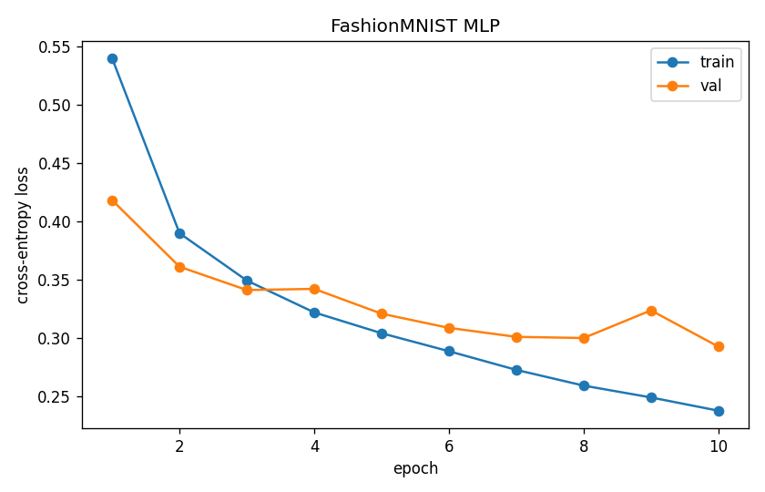
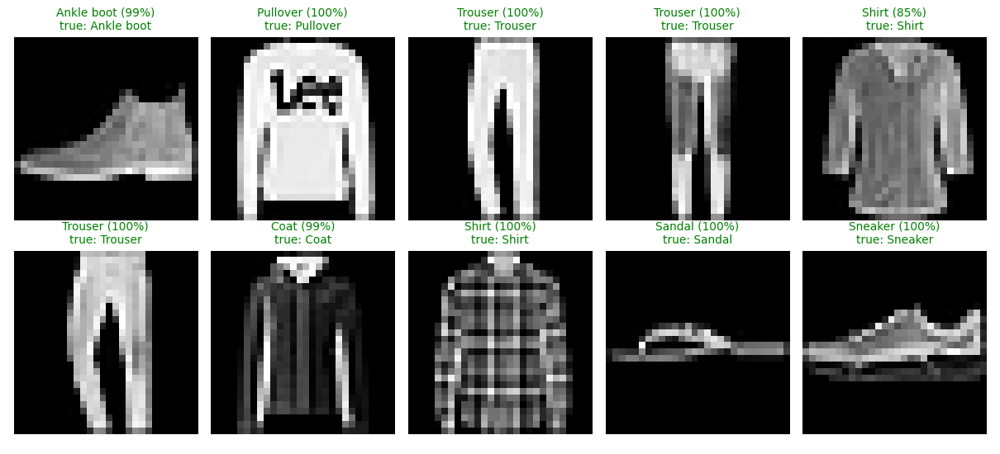
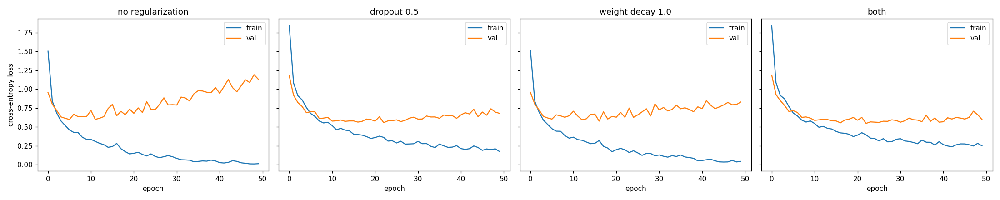

# 01 · Training loop

**Days 1–3.** Goal: explain the training and inference flow end to end, with numbers to back it up.

## Tasks
- [x] `gradient_descent.py`: fit a line with manual gradients, autograd, and nn+optim; learning-rate sweep
- [x] `train.py`: small network on FashionMNIST with train/val split; log train and val loss each epoch; save a checkpoint
- [x] `infer.py`: load the checkpoint, `model.eval()` + `torch.no_grad()`, predict on a few images, report accuracy and ms/batch
- [x] Overfitting: train on 1k samples with no regularization and plot the train/val gap; fix it with dropout or weight decay and plot again
- [x] GPU vs CPU time per epoch

## Day 1: Gradient descent

Fit `y = 3x + 2 + noise` (200 points, x ∈ [−5, 5], noise std 0.5), starting from w = b = 0.

### Three methods, one answer
- Manual gradients, autograd, and `nn.Linear` + `optim.SGD` give **identical** results (loss 0.3591, w = 3.000, b = 1.681 after 100 steps at lr=0.01). They use the same data, the same zero initialization and the same math. Autograd computes exactly the `mean(2·err·x)` / `mean(2·err)` I derived by hand.
- `loss.backward()` computes dL/dp for every parameter via the chain rule and stores it in `p.grad`.
- `opt.step()` reads `p.grad` and updates each parameter in place (`p -= lr · p.grad`). It can do this because the optimizer holds references to the model's own tensors.
- `opt.zero_grad()` clears `p.grad`. PyTorch *adds* new gradients onto old ones by default, so they must be reset every step.

### Learning rate
| lr (SGD, 100 steps) | final loss | w | b |
|---|---|---|---|
| 0.001 | 5.658 | 2.41 | 0.29 |
| 0.01 | 0.359 | 3.00 | 1.68 |
| 0.1 | 0.279 | 3.01 | 1.96 |
| 0.15 | inf | −5.5e18 | 2.0e17 |

- **w converges faster than b.** dL/dw carries an extra factor of x (up to ±5), so w's gradients are much larger. At lr=0.01, w reached 3.00 while b was still at 1.68.
- **lr=0.15 diverges.** For this data the loss curvature in w is 2·E[x²] ≈ 16.7, so plain SGD is stable only for lr < 2/16.7 ≈ 0.12. Above that, each step overshoots further than the last.
- **Loss floor ≈ 0.28**, close to the noise variance (0.5² = 0.25). No line can fit the noise. b settles at 1.96, not 2.00, because that's the best fit for this particular noisy sample.

### Optimizers (with defaults changed temporarily)
| 100 steps | lr=0.01 | lr=0.15 |
|---|---|---|
| SGD | b = 1.68 (slow) | diverges |
| SGD + momentum 0.9 | b = 1.95 | converges (loss 0.280) |
| Adam | w = 0.94, loss 36.6 (too slow) | converges (loss 0.281) |

- **Momentum** fixed the slow b (1.68 → 1.95). The curve is wavier because velocity carries it past the minimum, but the 0.9 decay damps the swings.
- **Adam** normalizes each gradient by its running magnitude (`m / √v`), so each step moves about lr no matter how big the gradient is. It's stable at lr=0.15 but can't move far at lr=0.01 (100 steps × 0.01 ≈ 1). This is the opposite of SGD's behaviour.
- Adam keeps 2 extra values per parameter (`exp_avg`, `exp_avg_sq`), so optimizer state is 2× the model size. That's a big part of why large models need FSDP/ZeRO.

### Breaking it on purpose
- **Removed `zero_grad`:** gradients accumulated across steps, so the loss oscillated like a sine wave and never converged. **There was no error**; it just trained wrong silently.
- **Removed `torch.no_grad()` around the manual update:** `RuntimeError: a leaf Variable that requires grad is being used in an in-place operation`. Autograd won't let you modify tensors it's tracking, which is why `optimizer.step()` runs under `no_grad` internally.
- **Removed `loss.backward()`:** the loss stayed constant. With no backward pass, `.grad` stays `None`, and the optimizer skips parameters without gradients, so `step()` silently does nothing.

**Takeaway:** the worst training bugs don't crash. Two of the three bugs here failed silently, so always watch the loss curve.

## Day 2: FashionMNIST MLP (`train.py`)

Setup: 50k train / 10k val, batch size 64, `Flatten → Linear(784,256) → ReLU → Linear(256,10)`, `CrossEntropyLoss`, Adam lr=1e-3, 10 epochs on the RTX 3050.

### Model size
- **Parameter count: 203,530**
- Breakdown (a Linear layer has `in × out` weights + `out` biases; Flatten and ReLU have none):

  | Layer | Weights | Biases | Total |
  |---|---|---|---|
  | Linear(784 → 256) | 784 × 256 = 200,704 | 256 | 200,960 |
  | Linear(256 → 10) | 256 × 10 = 2,560 | 10 | 2,570 |
  | **Total** | | | **203,530** |

- **The first layer holds 98.7% of the parameters.** It connects every one of the 784 input pixels to each of the 256 hidden units, so its size is the input size times the hidden size. The output layer only maps 256 → 10. The same pattern shows up in transformers: embedding and projection layers scale with vocabulary size × hidden size.

### Results
| | Epoch 1 | Epoch 10 |
|---|---|---|
| Train loss |  0.5396 | 0.2376 |
| Val loss | 0.4180 | 0.2925 |
| Val accuracy | 84.84% | 89.11% |

- Seconds per epoch (GPU): ~4s

### What the curves show
- **Not overfitting yet, but it's starting.** Val loss is still at its lowest at epoch 10 (0.2925), so more training hasn't hurt yet. But the curves crossed at epoch 3, and since then train loss keeps falling (0.35 → 0.24) while val flattens around 0.30. The train/val gap grows from ~0 to 0.055. That widening gap is the early sign; with 20–30 epochs val loss would start rising.
- **Why val loss was lower than train loss in epoch 1:** they're measured at different times. Train loss is the *average over the epoch*, so it includes the terrible loss from the first batches when the weights were random. Val loss is measured *once, at the end* of the epoch, after all 782 updates. The model being evaluated on val is simply better than the average model seen during training.
- **The bump at epoch 9** (val 0.30 → 0.32, then back to 0.29 at epoch 10) is **noise**, not a trend. A single-epoch spike that recovers comes from how that epoch's shuffled batches moved the weights. A trend would be val rising for several epochs in a row.

### Concepts
- **`model.train()` / `model.eval()`** set a mode flag that changes how certain layers *behave*: **Dropout** drops neurons only in train mode, and **BatchNorm** uses batch statistics in train mode but saved running averages in eval mode. They don't turn gradients on or off. This model has neither layer, so `eval()` changes nothing here yet; it will matter on Day 3 with dropout.
- **`torch.no_grad()`** stops autograd from *recording the computation graph*. It doesn't prevent weight updates by itself; weights only change when `opt.step()` runs, and evaluation never calls it. What it does is save memory and time, because no intermediate activations are stored for a backward pass.
- **Why evaluation uses both:** they do different jobs. `eval()` makes layers behave deterministically for prediction; `no_grad()` skips graph-building for speed and memory. Using only `no_grad()` would still apply dropout at eval, giving noisy, worse predictions. Using only `eval()` would waste memory building graphs nobody uses.
- **Why no softmax in the model:** `CrossEntropyLoss` expects raw **logits** and applies `log_softmax` internally, which is more numerically stable than softmax followed by log. Adding softmax yourself would apply it twice and train badly. For predictions, `argmax` of the logits gives the same class as `argmax` of the probabilities, so softmax isn't needed there either.
- **Loss of an untrained model ≈ 2.3:** random small weights give near-equal logits, so softmax gives about 1/10 probability to every class. Cross-entropy is −ln(p of the true class) = −ln(0.1) = **2.303**. So 2.3 means "guessing uniformly over 10 classes"; a starting loss far from this suggests a bug.
- **`state_dict`** is an ordered dictionary of parameter name → tensor (e.g. `1.weight` → shape [256, 784]). It holds **only the numbers, not the code or architecture**. So `infer.py` must first build the identical model with `build_model()` and then `load_state_dict()` into it. The names and shapes must match exactly, or loading fails.

### Infra observation
- **At ~4s/epoch the GPU is not the bottleneck; data loading is.** Each epoch the GPU does ~50k × 203k × 2 ≈ 20 GFLOPs forward (×3 with backward), which should take milliseconds. The time goes to the CPU: `ToTensor()` converts each image from PIL individually, in the main process (`num_workers=0`), and each small batch is copied to the GPU separately. The GPU is mostly idle, waiting for data.
- **How I'd confirm it:** time only the data loop (iterate the `DataLoader` without the model) and compare with the full epoch; watch `nvidia-smi` for low GPU utilization; or use `torch.profiler`.
- **What I'd try to speed it up:** `num_workers=2–4` (parallel loading; needs the `if __name__ == "__main__"` guard on Windows), `pin_memory=True` for faster CPU→GPU copies, a larger batch size, or preloading the whole dataset onto the GPU as one tensor (it's only 157 MB). *Day 3 tested these: preloading won 4.9×, while extra workers made it slower on Windows.*

## Day 3: Inference, overfitting, and the data pipeline

### Inference (`infer.py`)
Loads the Day 2 checkpoint (`build_model()` + `load_state_dict()`) and predicts on the **test set**: 10k images never used in training or validation.

- **Test accuracy: 88.43%**, about 0.7 pts below val (89.11%). That's the expected small drop on truly unseen data.
- **Per-class accuracy, worst first:** Shirt 63.6% · Pullover 81.2% · Coat 83.0% · T-shirt 87.6% · Dress 87.7% · Sneaker 92.4% · Bag 96.7% · Ankle boot 97.0% · Sandal 97.4% · Trouser 97.7%
  - **Shirt is by far the worst** because it looks like T-shirt, Pullover and Coat at 28×28 grayscale. The top-5 mistakes are all upper-body garments, while distinct shapes (trousers, sandals, bags) are nearly perfect. A pixel-by-pixel MLP has no notion of shape; a CNN would do better.
- **Logits → prediction:** logits `(B, 10)` are unbounded scores → `softmax(dim=1)` turns each row into probabilities summing to 1 → `.max(dim=1)` returns (confidence, class). `argmax` of logits gives the same class, so softmax is only needed for the confidence value.
- **Latency vs batch size** (GPU, median of 50 runs, input already built):

  | batch | ms/batch | images/s |
  |---|---|---|
  | 1 | 0.36 | ~2,800 |
  | 64 | 0.37 | ~174,000 |
  | 1024 | 0.71 | ~1,440,000 |

  **Batch 64 costs the same time as batch 1**, and batch 1024 only 2× more, for **500× the throughput**. At these sizes the time is fixed per-call overhead (Python, kernel launches, GPU→CPU copy), not compute. That's why inference servers batch requests together.

### Overfitting (`overfit.py`)
1,000 training images, a bigger MLP (784→512→512→10, **669,706 params**, 3.3× Day 2), 50 epochs, AdamW.

| Run | Final train loss | Best val loss (epoch) | Final val loss | Final val acc |
|---|---|---|---|---|
| No regularization | 0.013 | 0.599 (6) | 1.132 | 79.8% |
| Dropout 0.5 | 0.174 | 0.557 (23) | 0.680 | 81.1% |
| Weight decay 1.0 | 0.044 | 0.577 (17) | 0.830 | 78.7% |
| Both | 0.250 | **0.547** (23) | **0.599** | 80.6% |

- **Textbook overfitting:** train loss → 0.013 (memorized all 1,000 images) while val loss bottoms out at epoch 6, then climbs to 1.13. Every epoch after 6 made the model worse on new data.
- **Val loss nearly doubled while accuracy only fell ~1–2 pts:** the model became **overconfident**, wrong with near-certainty, which cross-entropy punishes heavily. Loss warns earlier than accuracy.
- **Dropout** was the strongest single fix: train loss can't reach zero, and overfitting starts at epoch 23 instead of 6. **Weight decay** helped less. **Both together** gave the flattest val curve, with final val loss half of the unregularized run.
- **Regularization delays memorization; it doesn't add information.** Every run plateaus around 80%, versus 89% with 50k images. More data is the real fix. **Early stopping** (keep the checkpoint from the best val epoch) is the practical complement.
- **Forgetting `model.eval()`:** with dropout left on, val accuracy drops ~2 pts (81.1% → 78.9%) **with no error**, and predictions become random between runs. That's why eval needs both: `eval()` for correct layer behaviour, `no_grad()` for memory and speed.
- In the dropout panels, train loss is *above* val for the first ~5 epochs, because train loss is measured with dropout on and val with it off.

### Data pipeline benchmark (`dataload_bench.py`)
Testing the Day 2 theory that the GPU is waiting on data.

| Test | Result | My prediction |
|---|---|---|
| DataLoader alone: `num_workers` 0 / 2 / 4 | 2.18s / 6.13s / 10.13s | 4 workers ≈ 4× faster ❌ |
| Epoch: standard loader vs preloaded on GPU | 4.38s → **0.89s (4.9×)** | not sure |
| CPU vs GPU, batch 64 (preloaded) | 1.62s vs 1.03s (1.6×) | GPU wins big ⚠️ |
| CPU vs GPU, batch 1024 (preloaded) | 0.39s vs 0.26s (1.5×) | GPU wins big ⚠️ |

- **More workers were *slower*.** On Windows each worker is a new Python process that re-imports PyTorch and receives a copy of the dataset (~2s each), recreated every epoch. The actual work is only ~2s, so startup cost dominates. Linux uses `fork` (near-instant), and `persistent_workers=True` avoids per-epoch restarts. **Parallelism only pays when the work is much bigger than its overhead.**
- **Preloading confirmed the theory:** ~80% of each Day 2 epoch was data loading (PIL decode + ToTensor + per-batch copy), not compute. That was possible only because the set is 157 MB; real datasets are TBs, which is why data pipelines are their own infra discipline.
- **The GPU barely beats the CPU** for a 203k-param model. Each step's math is tiny, so fixed per-step overhead (Python, kernel launches) dominates and the GPU idles. GPUs pay off on large matrix multiplications.
- **Batch size beat the device:** 64 → 1024 made *both* CPU and GPU ~4× faster (49 steps instead of 782, so 16× less per-step overhead). The biggest speedups in this whole experiment came from the data pipeline and batching, not from CPU → GPU.
- **Noise:** the same config (GPU, batch 64, preloaded) measured 0.89s and 1.03s, a 15% run-to-run difference. Single timings aren't trustworthy; Experiment 04 uses warm-ups and medians.

## Experiment 01 summary
- The training loop is 4 lines (`zero_grad → forward+loss → backward → step`) whatever the model; the worst bugs in it fail silently.
- A 203k-param MLP reaches 88.4% test accuracy on FashionMNIST; Shirt (63.6%) is the hard class.
- With little data, a bigger model memorizes (train 0.013 vs val 1.13); dropout + weight decay delay it, more data fixes it.
- For small models, **performance is about overhead, not compute**: data loading was 80% of epoch time, and batching gave 500× inference throughput at 2× latency.
