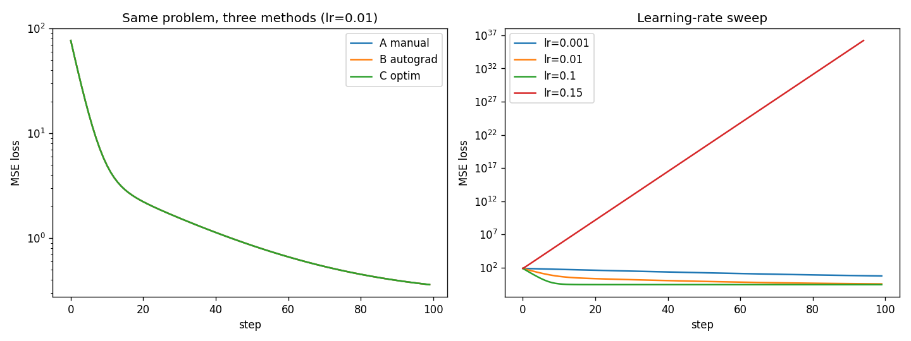

# 01 · Training loop

**Days 1–3.** Goal: explain the training and inference flow end to end, with numbers to back it up.

## Tasks
- [x] `gradient_descent.py`: fit a line with manual gradients, autograd, and nn+optim; learning-rate sweep
- [ ] `train.py`: small network on FashionMNIST with train/val split; log train and val loss each epoch; save a checkpoint
- [ ] `infer.py`: load the checkpoint, `model.eval()` + `torch.no_grad()`, predict on a few images, report accuracy and ms/batch
- [ ] Overfitting: train on 1k samples with no regularization and plot the train/val gap; fix it with dropout or weight decay and plot again
- [ ] GPU vs CPU time per epoch

## Day 1: Gradient descent

Fit `y = 3x + 2 + noise` (200 points, x ∈ [−5, 5], noise std 0.5), starting from w = b = 0.

### Three methods, one answer
- Manual gradients, autograd, and `nn.Linear` + `optim.SGD` give **identical** results (loss 0.3591, w = 3.000, b = 1.681 after 100 steps at lr=0.01). They use the same data, the same zero initialization and the same math. Autograd computes exactly the `mean(2·err·x)` / `mean(2·err)` I derived by hand.
- `loss.backward()` computes dL/dp for every parameter via the chain rule and stores it in `p.grad`.
- `opt.step()` reads `p.grad` and updates each parameter in place (`p -= lr · p.grad`). It can do this because the optimizer holds references to the model's own tensors.
- `opt.zero_grad()` clears `p.grad`. PyTorch *adds* new gradients onto old ones by default, so they must be reset every step.

### Learning rate
| lr (SGD, 100 steps) | final loss | w | b |
|---|---|---|---|
| 0.001 | 5.658 | 2.41 | 0.29 |
| 0.01 | 0.359 | 3.00 | 1.68 |
| 0.1 | 0.279 | 3.01 | 1.96 |
| 0.15 | inf | −5.5e18 | 2.0e17 |

- **w converges faster than b.** dL/dw carries an extra factor of x (up to ±5), so w's gradients are much larger. At lr=0.01, w reached 3.00 while b was still at 1.68.
- **lr=0.15 diverges.** For this data the loss curvature in w is 2·E[x²] ≈ 16.7, so plain SGD is stable only for lr < 2/16.7 ≈ 0.12. Above that, each step overshoots further than the last.
- **Loss floor ≈ 0.28**, close to the noise variance (0.5² = 0.25). No line can fit the noise. b settles at 1.96, not 2.00, because that's the best fit for this particular noisy sample.

### Optimizers (with defaults changed temporarily)
| 100 steps | lr=0.01 | lr=0.15 |
|---|---|---|
| SGD | b = 1.68 (slow) | diverges |
| SGD + momentum 0.9 | b = 1.95 | converges (loss 0.280) |
| Adam | w = 0.94, loss 36.6 (too slow) | converges (loss 0.281) |

- **Momentum** fixed the slow b (1.68 → 1.95). The curve is wavier because velocity carries it past the minimum, but the 0.9 decay damps the swings.
- **Adam** normalizes each gradient by its running magnitude (`m / √v`), so each step moves about lr no matter how big the gradient is. It's stable at lr=0.15 but can't move far at lr=0.01 (100 steps × 0.01 ≈ 1). This is the opposite of SGD's behaviour.
- Adam keeps 2 extra values per parameter (`exp_avg`, `exp_avg_sq`), so optimizer state is 2× the model size. That's a big part of why large models need FSDP/ZeRO.

### Breaking it on purpose
- **Removed `zero_grad`:** gradients accumulated across steps, so the loss oscillated like a sine wave and never converged. **There was no error**; it just trained wrong silently.
- **Removed `torch.no_grad()` around the manual update:** `RuntimeError: a leaf Variable that requires grad is being used in an in-place operation`. Autograd won't let you modify tensors it's tracking, which is why `optimizer.step()` runs under `no_grad` internally.
- **Removed `loss.backward()`:** the loss stayed constant. With no backward pass, `.grad` stays `None`, and the optimizer skips parameters without gradients, so `step()` silently does nothing.

**Takeaway:** the worst training bugs don't crash. Two of the three bugs here failed silently, so always watch the loss curve.
