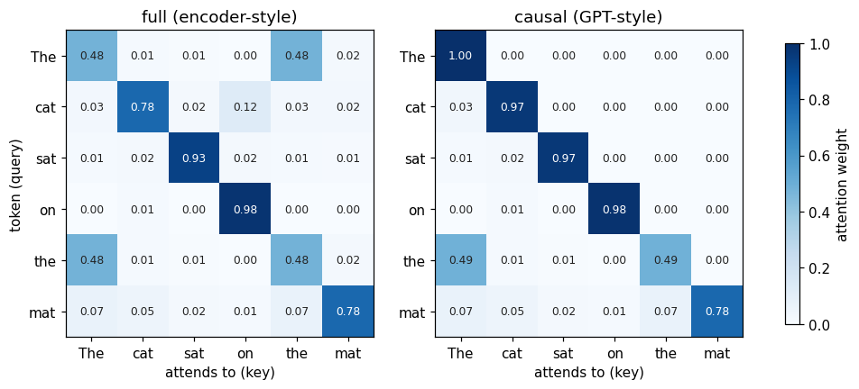

# 02 · Transformer building blocks

**Days 4–5.** Goal: tokenization → embeddings → attention, each implemented by hand and checked against PyTorch.

## Tasks
- [x] Tokenize text with `tiktoken`; compare tokens per word on English, code, and another language
- [x] Batch variable-length sequences: padding + attention mask; measure the padding waste (%)
- [x] `nn.Embedding` lookup; cosine similarity between a few sentence embeddings
- [x] Scaled dot-product attention by hand, with a causal mask; `torch.allclose` against `F.scaled_dot_product_attention`
- [x] Multi-head: reshape to (B, heads, T, d_head) and back

## Day 4: Text → tokens → padded batch → embeddings (`tokenize_embed.py`)

```
"The cat sat"  →  [791, 8415, 7731]  →  ids + mask (B, T)  →  vectors (B, T, D)  →  sentence vector (B, D)
   text           tokenizer              pad_batch             nn.Embedding / model    mean_pool
```

### A. Tokenization
| Text | Chars | gpt2 (50k vocab) | cl100k (100k vocab) |
|---|---|---|---|
| English | 44 | 10 tok (4.4 ch/tok) | 10 tok (4.4 ch/tok) |
| Code | 31 | 15 tok (2.1) | 11 tok (2.8) |
| Hindi | 32 | 53 tok (**0.6**) | 35 tok (**0.9**) |
| Rare word | 45 | 15 tok (3.0) | 17 tok (2.6) |
| Numbers | 49 | 19 tok (2.6) | 21 tok (2.3) |

- **Tokens aren't words.** Common English words are one token each, with the leading space included (`' quick'`).
- **Hindi costs 5–7× more tokens per character than English.** The tokenizers were trained mostly on English. More tokens means higher API cost, slower generation, and more of the context window used up for the same meaning.
- **Tokenizers work on bytes:** a Devanagari character is 3 bytes in UTF-8, and some tokens hold only part of one (`�`). So nothing is ever out of vocabulary: the rare word becomes 17 subword pieces (`P`, `ne`, `um`, …).
- **A bigger vocabulary helps code and non-English** (code 15 → 11, Hindi 53 → 35), at the cost of a bigger embedding table.
- **Numbers split into chunks** (`1234567` isn't one token), which is part of why LLMs struggle with arithmetic.

### B. Padding + attention masks
- `pad_batch` right-pads to the longest sequence and returns `ids` and `mask` (1 = real, 0 = pad), both `(B, T_max)`.
- **The pad id 0 is a real token in cl100k (`'!'`).** Only the mask tells the model which positions are padding, so the mask must always travel with the ids.
- **Padding waste**, 512 sequences of 5–200 tokens, batch size 32:
  - batches in arrival order: **50%** of positions are padding
  - batches sorted by length: **6%**
- Every padded position still costs GPU compute and memory, so random batching wastes half the work. That's why inference servers bucket requests by length or use continuous batching (e.g. vLLM).

### C. Embeddings
- **`nn.Embedding` is a lookup table:** `emb(ids) == emb.weight[ids]` → True. `(B, T)` ids → `(B, T, D)` vectors. Row *i* is the vector for token *i*.
- **The table is big at scale:** 100k × 64 = 6.4M params here; 100k × 4096 = 411M (0.8 GB bf16) for a 7B-class model; 128k × 8192 ≈ 1B (2.1 GB) for a 70B-class model.
- **Masked vs naive mean:** for the shortest sentence (6 real tokens, 7 pads), `mean(dim=1)` differed from the masked mean by **128%**. The padding dominated the average.
- **Random vs trained embeddings**, cosine similarity with "The cat sat on the mat.":

  | Sentence | Random `nn.Embedding` | Trained MiniLM |
  |---|---|---|
  | A kitten was sitting on the rug. | 0.57 | 0.65 |
  | Stock markets fell sharply today. | 0.33 | 0.04 |
  | Shares dropped across global exchanges… | 0.04 | 0.03 |
  | How do I reset my password? | −0.14 | 0.08 |
  | I forgot my login credentials… | −0.10 | 0.01 |

  

  - **Random embeddings measure word overlap, not meaning.** Cat ↔ kitten scored 0.57 only because they share ` on`, ` the`, `.`, and cat ↔ stocks scored 0.33 from sharing `.`.
  - **The trained model groups by meaning:** stocks ↔ shares 0.57 and password ↔ login 0.69, even though those pairs share **no words**. Unrelated topics sit near 0.
  - **Embeddings only mean something after training.** Embed → mean-pool → cosine similarity is the core of semantic search and RAG.

### PyTorch concepts that clicked today
- **`dim=N` collapses axis N**: `(B, T, D).sum(dim=1)` → `(B, D)`. Cross the named axis out of the shape. dim 0 is almost always the batch, so most reductions use `dim=1` or `dim=-1`.
- **Broadcasting:** shapes line up from the right, and size-1 axes stretch to match. `(B, T, D) * (B, T, 1)` works; `(B, T, D) * (B, T)` doesn't. Hence `unsqueeze(-1)` in `mean_pool` and `keepdim=True` in the cosine norm.
- **Masks do math too:** multiplying by a 0/1 mask zeros out padding before a sum (Day 3 used masks to *select*; today they *weight*).
- **All-pairs similarity = one matrix multiply:** normalize the rows, then `normed @ normed.T` → `(N, N)`. Attention's `Q @ K.T` (Day 5) is the same shape of computation.

## Day 5: Attention from scratch (`attention.py`)

```
x (B,T,D) ─► q,k,v = Linear(x) ─► split_heads (B,H,T,d) ─► softmax(q·kᵀ/√d [+causal mask]) · v ─► merge_heads (B,T,D) ─► out_proj
```

### A. Scaled dot-product attention
- `scores = q @ k.transpose(-2,-1) / √d` → `(…, T, T)`: every token's query compared with every token's key.
- `softmax(dim=-1)`: each row turns into one token's distribution over the tokens it looks at (rows sum to 1).
- `out = weights @ v`: each token's output is a **weighted average of the value vectors**. In the hand example, token 2 `[1,1]` weights `[.25,.25,.5]` → output `[5,5]`.
- **Why √d:** a dot product of d random numbers has a spread of about √d. Without the scaling, a large d makes softmax nearly one-hot, and gradients vanish. T doesn't affect the spread of a single score, so the scaling uses d, not T.
- **Causal mask:** `triu(ones, diagonal=1)` marks the future, and `masked_fill(-inf)` makes `exp(-inf)=0`, so token i only sees tokens 0..i. Zeros above the diagonal; the first row is `[1, 0, 0, …]`.
- Matches `F.scaled_dot_product_attention` both with and without the causal mask (max diff ~1e-7).

### B. The picture

- Full (encoder/BERT-style): every token can see every token. Causal (GPT-style): a lower triangle. "The" can only see itself.
- Identical vectors ("The" / "the") attend strongly to each other: attention is similarity-based lookup.

### C. Multi-head
- `split_heads`: `view(B,T,H,d_head)` + `transpose(1,2)` → `(B,H,T,d_head)`. Each head gets its own slice of each token's numbers (head 1 = numbers 4..7) and attends independently. The same `attention()` works because it only uses the last two axes.
- `merge_heads`: `transpose` → `contiguous()` → `view`. `transpose` only changes the *strides* (how memory is read), and `view` needs the data physically in order, so `contiguous()` makes a reordered copy (`reshape` = this, done automatically).
- `nn.Linear(in, out)` = `x @ W.T + b` on the last axis. q/k/v/out projections = 4 × (16·16+16) = **1,088 params**. These are the learned part; attention itself has no weights.
- PyTorch stores q/k/v as one stacked `(3D, D)` `in_proj_weight` (a **fused QKV** projection: one big matmul beats three small ones on a GPU). Copied my weights into it and got **matches `nn.MultiheadAttention`: True** (causal and not).

### D. Infra: cost vs sequence length (GPU, fp16, B=1, 8 heads, d_head=64)
| T | scores (H,T,T) | mine: ms | mine: extra MB | F.sdpa: ms | F.sdpa: extra MB |
|---|---|---|---|---|---|
| 512 | 4 MB | 0.29 | 9 | 0.06 | 1 |
| 1,024 | 17 MB | 1.07 | 36 | 0.13 | 1 |
| 2,048 | 67 MB | 6.37 | 141 | 0.50 | 2 |
| 4,096 | 268 MB | 18.89 | 558 | 1.41 | 4 |
| 8,192 | 1,074 MB | 68.45 | **2,223** | 4.85 | **8** |

- **Memory is quadratic in T:** double T → scores 4× (T appears twice in `(T, T)`). q/k/v only grow 2×.
- **Mine uses about 2× the scores size:** `scores`, the masked copy, and the softmax weights are each a full `(H,T,T)` tensor that's alive at the same time.
- **F.sdpa (FlashAttention-style) never materializes the T×T matrix.** It works on tiles in on-chip SRAM with an online softmax. That's **278× less memory and 14× faster at 8k**, with memory growing only linearly. Same math, different memory traffic: attention is memory-bound, not compute-bound.
- At scale: 1 GB of scores × 32 layers × a batch of users → long context is impossible without fused kernels. That's why FlashAttention, and why the KV cache size matters for serving (Day 8).

### PyTorch concepts that clicked today
- `transpose(-2, -1)` swaps the last two axes, whatever comes before them (works for `(T,d)`, `(B,T,d)`, `(B,H,T,d)`).
- `view` vs `reshape` vs `contiguous`: same numbers regrouped, but `view` requires contiguous memory.
- Trailing `_` = in-place (`copy_`, `masked_fill_`). Editing parameters needs `torch.no_grad()`.
- GPU timing: warm up, `torch.cuda.synchronize()` before starting and stopping the clock (the GPU runs async), and `max_memory_allocated` for the peak.
