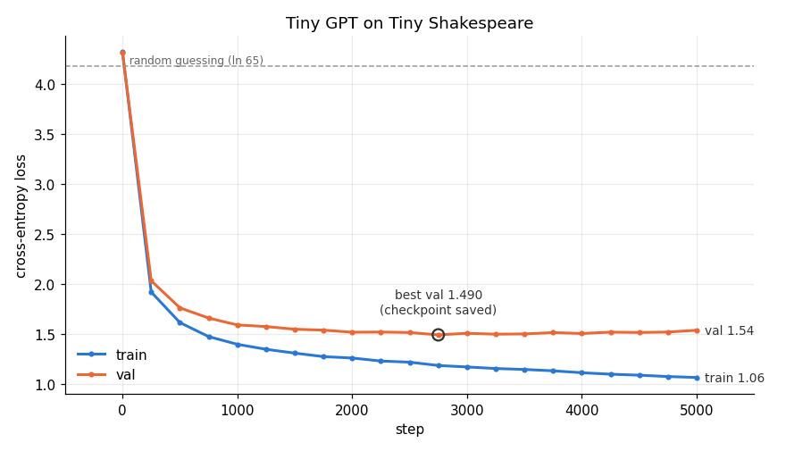

# 03 · Tiny GPT

**Days 6–8.** Goal: a character-level GPT (~1–5M params) trained on Tiny Shakespeare, trained and sampled end to end.

## Tasks
- [x] Data: character vocab, train/val split, random (B, T) batches
- [x] Model: embeddings + N transformer blocks (reuse your attention from 02) + LM head
- [x] Train on the RTX 3050; log train/val loss; save a checkpoint (5,000 steps, 4.6 min)
- [x] `generate.py`: load the checkpoint and sample autoregressively (greedy + temperature)
- [x] Record: param count, tokens/sec during training, peak GPU memory


## Day 6: Data + model + sanity check (`gpt.py`)

```
text ─► char ids (1-D, 1.1M) ─► get_batch: x, y (B, T) ─► tok_emb + pos_emb (B,T,D) ─► 4 × Block ─► ln_f ─► lm_head ─► logits (B,T,65) ─► cross_entropy
                                                                                      Block: x = x + attn(ln1(x), causal)   ← my Day 5 attention
                                                                                             x = x + mlp(ln2(x))
```

### A. Data
- Tiny Shakespeare: 1,115,394 characters, **vocab = 65** (one token per character), 90/10 train/val split.
- `get_batch`: `randint(0, len - T, (B,))` random starts (`high` is exclusive, so the last start still leaves room for y), then `torch.stack` the windows → `(B, T)`.
- **y = x shifted by one.** One window of T characters = T training examples (`'h'→'e'`, `'he'→' '`, …): the model predicts the next character at every position at once.
- `stack` adds a NEW axis (B windows of `(T,)` → `(B, T)`); `cat` glues along an existing axis (Day 5's q/k/v weights → `(3D, D)`).

### B. Model (`Config`: T=128, D=256, 4 heads, 4 layers)
| Part | Params |
|---|---|
| Embeddings (tok + pos) | 49,408 |
| One block: attention / MLP | 263,168 / 525,568 |
| 4 blocks | 3,159,040 (98%) |
| lm_head | 16,705 |
| **Total** | **3,225,665** |

- **The MLP is 2× attention in every block:** 8·D² (D→4D→D) vs 4·D² (q, k, v, out). Most of a transformer's parameters are in the MLPs.
- The embeddings are tiny because the vocab is 65 (vs 411M for a 100k × 4096 table, Day 4).
- **Untrained loss 4.29 ≈ ln(65) = 4.17**: random guessing among 65 characters (Day 2: 2.30 = ln 10).
- `pos_emb(arange(T))` is `(T, D)` with no B axis, because position t means the same thing in every sequence; broadcasting adds it to all B rows. Without it, attention has no notion of order.
- Loss: `cross_entropy(logits.view(B*T, -1), targets.view(B*T))`. Every position is one prediction; the targets are class **indices** `(N,)`, not scores.
- Residual `x = x + f(x)` works because the shape stays `(B, T, D)` through every block; gradients flow straight back through the `+`.

### C. Sanity check: overfit one batch
- The same batch (16 × 128) for 300 steps: loss **4.31 → 0.006** in 5.4 s, **~114k tokens/sec** (RTX 3050, my naive attention).
- Proves that the model, gradients, and optimizer are wired correctly *before* a long run. Memorizing one batch ≠ learning; the val loss on Day 7 is the real test.

### Bugs I hit
- `if targets:` → "Boolean value of Tensor … ambiguous". Use `if targets is not None:`.
- Forgot `ln_f` before `lm_head`: no error, it just trains worse. Silent bugs only get caught by review/checks.

## Day 7: Training for real (`train.py`)

`python train.py --bench` · `python train.py` (attention = F.sdpa, 5,000 steps × 64 × 128 = 41M tokens ≈ 41 passes over the train set)

### Benchmark: my attention vs F.sdpa inside the full model (8,192 tokens/batch either way)
| T | B | mine: tok/s | F.sdpa: tok/s | speedup | peak MB (mine → sdpa) |
|---|---|---|---|---|---|
| 128 | 64 | 139k | 161k | **1.16×** | 747 → 680 |
| 512 | 16 | 93k | 131k | **1.42×** | 1,001 → 680 |

- **Not 14× like Day 5: Amdahl's law.** F.sdpa only replaces the attention *core* (scores → mask → softmax → @v). The q/k/v/out projections, the MLP, layernorms, backward and the optimizer are unchanged, and at T=128 they're most of the step.
- **The speedup grows with T:** the core costs ∝ T per token, the Linear layers don't depend on T, so attention's share of the step grows. My version slows 34% from T=128 → 512; sdpa slows 18%, and its memory stays flat.
- Takeaway: optimize the biggest slice. At long context (32k+), attention dominates and fused kernels become essential.

### Training run


| step | train | val | |
|---|---|---|---|
| 0 | 4.318 | 4.314 | random guessing (ln 65 = 4.17) |
| 500 | 1.613 | 1.760 | easy patterns: letters, spaces, common pairs |
| 1,000 | 1.396 | 1.589 | |
| 2,750 | 1.184 | **1.490** | **best val → checkpoint saved** |
| 5,000 | 1.064 | 1.537 | train still falling, val rising → overfitting |

- **Throughput 156,880 tokens/sec, peak GPU memory 680 MB, 276 s total**, RTX 3050, fp32, F.sdpa.
- **Overfitting after ~2,750 steps:** the gap grows from 0.30 to 0.48. 3.2M params vs 1M characters is enough capacity to memorize. **Saving the best checkpoint = automatic early stopping**: the last 2,250 steps used compute and made the model worse.
- val 1.49 → e^1.49 ≈ 4.4: about as uncertain as choosing among ~4.4 equally likely next characters (vs 65 at the start).
- Fixes for the overfitting: more dropout, weight decay (AdamW `weight_decay`), a smaller model, more data, or stop earlier. (Gradient clipping, random batches, and a bigger val set don't reduce overfitting: clipping is for stability, the batches are already random, and val only *measures* it.)
- The step-0 loss of 4.31 is slightly above 4.17: random init gives slightly non-uniform, "confidently wrong" logits.

### Scale check
- My GPU at 157k tok/s, GPT-3's 300B tokens: 300e9 / 157k ≈ 1.9M s ≈ **22 days, for a 3.2M-param model.**
- Training compute per token ∝ params (≈ 6 × N FLOPs). GPT-3 is 175B params ≈ 54,000× mine → **~3,000 years on this GPU.** It actually took ~thousands of A100s for weeks, hence clusters, data/tensor/pipeline parallelism, and fast interconnects (NVLink, InfiniBand). That's the ML infra job.

### New this day
- `clip_grad_norm_(params, 1.0)`: after backward, before step; caps the total gradient length so one bad batch can't blow up the weights.
- `estimate_loss`: `eval()` → average 20 batches per split under `no_grad` → `train()`. My bugs: `[]` vs `{}`, `A and B` (returns B, doesn't combine), `for i in 20` (needs `range`), passing `i` as the batch size (a silent bug).

## Day 8: Generation (`generate.py`)

```
idx (B, T) ─► crop to the last 128 ─► model ─► logits (B, T, 65) ─► [:, -1, :] (B, 65) ─► pick_next (B, 1) ─► cat(dim=1) ─► (B, T+1) ─► repeat
```
- **Autoregressive:** predict one token, append it, feed it back in. Same model and weights as training; no `y`, loss = None, only the **last** position's logits are used.
- `idx[:, -128:]` = **the context window**: `pos_emb` has 128 rows, so older text is forgotten.
- `pick_next`: greedy = `argmax(dim=-1, keepdim=True)`; sampling = `softmax(logits / temp)` → `multinomial(probs, 1)` (a weighted dice roll per row → `(B, 1)`).
- **B = independent texts generated in parallel.** Attention mixes along T (within a row), never across B.

### A. Untrained vs trained (temp 1.0, same seed)
- Untrained: uniform random characters (`PuD?&!IRnhe3CTe…`).
- Trained (val 1.49): the play's format (`Second Senator:` + newline), real words, plausible rhythm, invented words (`agine`, `lovelows`), no meaning. A character-level model learns spelling and form before sense.

### B. Temperature
| temp | P(next char) after "…yonder w" (top 3) |
|---|---|
| 0.5 | i 0.68 · e 0.16 · a 0.12 |
| 1.0 | i 0.44 · e 0.21 · a 0.19 |
| 1.5 | i 0.34 · e 0.21 · a 0.19 |

- `logits / temp` before the softmax: t < 1 sharpens, t > 1 flattens; the ranking never changes.
- **Greedy loops:** "of the state of the state of the state…". Deterministic + the same context → the same choice → a cycle. The most likely next token ≠ the most likely text. (My prediction was "greedy = the best text": wrong.)
- 0.5 = safe/repetitive, 1.0 = the model's real distribution, 1.5 = invented words. Same `temperature` knob as LLM APIs.

### C. Infra: cost per token vs context (no KV cache)
| device | context | ms / token | wasted positions |
|---|---|---|---|
| GPU | 1–50 | 1.24 | 96% |
| GPU | 128 | 1.23 | 99% |
| CPU | 1–50 | 3.30 | 96% |
| CPU | 128 | 5.26 | 99% |

- **GPU: flat.** A 3.2M-param model is **overhead-bound**: each step launches ~100 tiny kernels, and that fixed cost dwarfs the math for 128 positions. **CPU: grows 1.6×** because it actually does the extra compute.
- **99% waste:** at context 128, 128 positions are computed to use 1. Old tokens' keys/values never change → a **KV cache** stores them and each step processes 1 new position. For a 7B model (compute-bound), this is the difference between usable and unusable.

### D. Infra: batched generation (GPU, 100 tokens each)
| users (B) | ms / step | tokens/sec | vs B=1 |
|---|---|---|---|
| 1 | 1.25 | 803 | 1× |
| 8 | 1.60 | 4,998 | 6× |
| 32 | 4.17 | 7,667 | 10× |
| 128 | 14.35 | 8,921 | 11× |
| 256 | 27.63 | 9,265 | 12× |

- **Up to ~8 users: almost free** (the GPU was idle). Beyond ~32 the GPU is **saturated**: ms/step doubles when B doubles, and throughput plateaus at ~9k tok/s, **12×, not 256×**.
- **Latency vs throughput trade-off:** at B=256, each user waits 27.6 ms per token (22× slower) while the server produces 12× more total. Serving = picking the batch size that meets a latency SLO at max throughput. That's why vLLM/TGI do **continuous batching**.
- Without a KV cache, every user recomputes up to 128 positions per step, so the ceiling is lower than it needs to be.

### Transformers vs RNNs (my question)
- The win is **training**: all T positions in one pass (the causal mask), vs an RNN's sequential `h_t = f(h_{t-1}, x_t)`. Plus direct long-range attention vs squeezing everything into one hidden vector.
- `pos_emb` is the *cost* of parallelism (attention has no order), not its cause.
- Generation is sequential for both; a transformer's per-token cost and KV memory grow with context, while an RNN's are constant. Hence Mamba/RWKV/SSMs.
