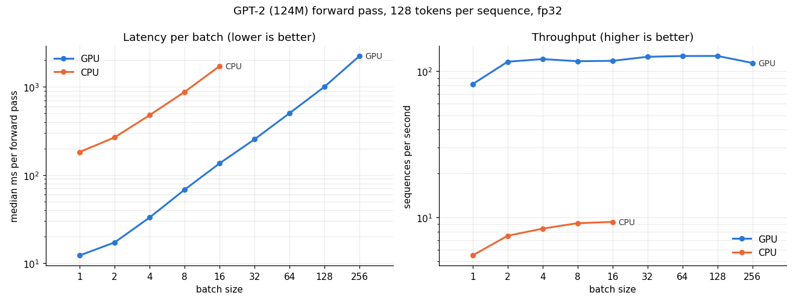
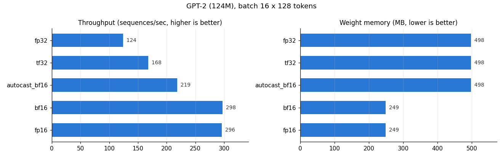

# 04 · Inference benchmark

**Days 9–11.** Goal: the infra experiment. Measure how batching, device, and precision change latency, throughput, and memory.

## Tasks
- [x] Benchmark harness: warm-up runs, `torch.cuda.synchronize()` before timing, median over N runs
- [x] Batch size sweep (1 → OOM): latency/batch, samples/sec, peak memory (`torch.cuda.max_memory_allocated`)
- [x] CPU vs GPU at each batch size
- [x] fp32 vs TF32 vs bf16/fp16 (`torch.autocast` and converted weights)
- [ ] Generation: time-to-first-token vs per-token latency for the tiny GPT
- [x] Charts: throughput vs batch size, latency vs batch size

## Day 9: Harness + batch sweep on GPT-2 (`bench.py`)

GPT-2 small: 124M params, 12 layers, d_model 768, vocab 50,257 · 498 MB of weights in fp32 · ~0.25 GFLOPs/token.
Each run = one forward pass ("prefill") over B sequences × 128 tokens. RTX 3050 (8 GB) vs CPU (14 threads), fp32.

### The harness (`measure`, `peak_memory_mb`)
1. **Warm up** (skip the one-time CUDA init / kernel selection / allocation costs).
2. **`torch.cuda.synchronize()` before starting AND stopping the clock.** The GPU is async; without it you time the *queueing*.
3. **Repeat; report the median + p95.** The median resists one slow run; p95 is the tail that SLOs are written against.
- Peak memory: `reset_peak_memory_stats()` → `base = memory_allocated()` → run → `max_memory_allocated() - base` = the extra memory one pass needs.
- p95 stayed within ~5% of the median → stable measurements.

### Results

| batch | GPU median ms | GPU seq/s | GPU TFLOPS | GPU peak MB | CPU median ms | CPU seq/s |
|---|---|---|---|---|---|---|
| 1 | 12.2 | 82 | 2.60 | 36 | 182 | 5.5 |
| 2 | 17.2 | 116 | 3.71 | 72 | 267 | 7.5 |
| 4 | 33.0 | 121 | 3.86 | 151 | 478 | 8.4 |
| 16 | 135.6 | 118 | 3.76 | 569 | 1,719 | 9.3 |
| 128 | 1,004 | 127 | 4.06 | 4,553 | | |
| 256 | 2,244 | 114 | 3.63 | 9,104 ⚠️ spilled | | |
| 512 | OOM | | | | | |

### What I learned
- **Prefill fills the GPU even at batch 1.** From batch 4 on, 2× the batch = 2× the time; throughput plateaus at ~127 seq/s. Day 8's *decode* (1 token/step, tiny model) was the opposite: batch 8 ≈ batch 1. **Batching helps in proportion to how idle the GPU is**, which is why servers treat prefill and decode differently (chunked prefill, disaggregated serving).
- Batch 1 → 2: +41% throughput because the fixed per-pass overhead (kernel launches, Python) gets amortized over 2 sequences, and the bigger matrices keep more of the GPU busy (Day 3's amortization again). Not warm-up: that's excluded by the harness.
- **GPU ≈ 14–15× faster than CPU** (4.1 vs 0.30 TFLOPS), in fp32 without tensor cores. Day 10 tests bf16.
- **Memory is dominated by the logits, not the weights.** ~35.6 MB per sequence, of which the `(128 × 50,257)` fp32 logits are 26 MB (73%). At batch 256: 9.1 GB of activations vs 0.5 GB of weights. Generation only needs the last position's logits (`logits_to_keep=1` in HF) → 99% of that tensor is avoidable.
- **Windows spilled to system RAM at batch 256** (9.1 GB > 8 GB VRAM): no OOM, just 10% *lower* throughput. A silent slowdown is worse than a crash; on a Linux server it would OOM.
- **🎯 The interview number, the latency/throughput knee:** batch 4 = 33 ms at 95% of peak throughput; batch 128 = 1,004 ms for the last 5%. Pick the batch size from the latency SLO, not max throughput. Batch 512 → OOM; 256 → spills and is *slower*.

## Day 10: Precision on GPT-2 (`precision.py`)

The same forward pass (batch 16 × 128 real Shakespeare tokens) in 5 modes on the RTX 3050. Accuracy is compared with fp32.

### Formats (fp = floating point · bf = "brain float", Google Brain · tf32 = NVIDIA TensorFloat-32)
| format | exponent (range) | mantissa (precision) | max | step near 1.0 |
|---|---|---|---|---|
| fp32 | 8 | 23 | 3.4e38 | 1.2e-7 |
| tf32 | 8 | 10 | 3.4e38 | 0.001 (matmul inputs only, stored as fp32) |
| bf16 | 8 | 7 | 3.4e38 | 0.0078 |
| fp16 | 5 | 10 | **65,504** | 0.001 |

bf16 = fp32's range with fewer digits. fp16 = more digits, but it overflows (70000 → inf) and tiny values flush to 0 (1e-8 → 0).

### Results

| mode | weights MB | median ms | speedup | TFLOPS | est. max batch | loss | same top-1 |
|---|---|---|---|---|---|---|---|
| fp32 | 498 | 127.4 | 1.0× | 4.0 | 219 | 4.6112 | 100% |
| tf32 | 498 | 95.5 | 1.33× | 5.3 | 219 | 4.6108 | 99.46% |
| autocast_bf16 | 498 | 72.9 | 1.75× | 7.0 | 226 | 4.6118 | 88.13% |
| bf16 | **249** | **51.1** | **2.5×** | **10.0** | **451** | 4.6109 | 88.57% |
| fp16 | 249 | 51.1 | 2.5× | 10.0 | 451 | 4.6110 | 98.24% |

### What I learned
- **bf16 inference = 2.5× faster, half the weights, 2× the batch (219 → 451), and the same loss (±0.01%).** More than 2× because tensor cores only run at reduced precision (4 → 10 TFLOPS), on top of moving half the bytes.
- **TF32 = 1.33× for one flag and zero code changes** (`torch.set_float32_matmul_precision("high")`).
- **autocast keeps fp32 weights** → no weight-memory saving, plus a cast on every call (1.75×). It is the standard for *training* (fp32 master weights so small updates aren't rounded away); converted bf16 weights are the standard for *inference*.
- **🧩 The same loss, but ~11.5% of the top-1 tokens flip in bf16.** GPT-2's logits are about -100, where bf16 can only represent steps of 0.5. The flipped positions were near-ties (median top-2 gap 0.13 vs 0.94 where they agreed). At a 50/50 position the winner changes but the probabilities barely do, so the loss doesn't move. fp16 (10 mantissa bits, 8× finer steps) flips only 1.8%; its range limit doesn't matter for logits around 100.
- **Infra takeaway:** lower precision ≠ bit-identical outputs. Greedy text *will* differ after a precision/GPU change, which is expected, not a bug. Judge quality with aggregate metrics (loss / eval scores), not exact-match. Quantization (int8/int4) is the same trade pushed further.
- Measurement lesson: the first run said **100% top-1 everywhere**, because the script ran before the `out_top` fix was saved (it compared ref with ref). A result that looks too perfect → suspect the measurement first.

